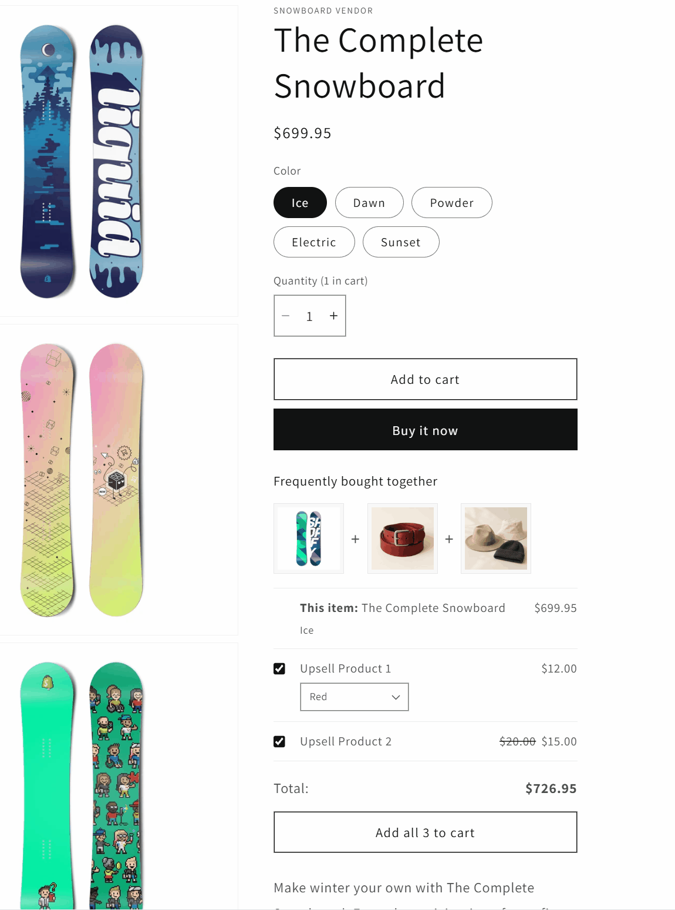

# Fashion Demo: a customized Dawn theme

A Shopify theme for a fashion store, built by customizing Shopify's [Dawn](https://github.com/Shopify/dawn) theme (version 16.0.0). I built it to learn Shopify theme development: Liquid, section and block schemas, theme settings, translations and the theme's JavaScript.

**Skills shown:** Liquid templating, section and block schemas, metafields, JavaScript custom elements, Dawn's event system, Shopify's AJAX Cart API, translations and accessible markup.

The first commit in this repository is unmodified Dawn 16.0.0. Every commit after it contains the customizations, so you can see exactly what changed with:

```sh
git diff $(git rev-list --max-parents=0 HEAD) --stat
```

I built these customizations using AI tools, mainly Claude Code. I defined the requirements, made the architecture and UX decisions, reviewed the AI’s plans and code, and tested everything on a real Shopify store.

## Featured: "Frequently bought together"



A product page block that sits under the Add to cart button and offers the current product together with related products, so the shopper can buy them in one click.

- **Merchant setup:** the related products come from a product metafield (`custom.upsell_products`, a list of products). In the theme editor, the merchant adds the block to the product page and sets the heading and how many products to show.
- **What the shopper sees:** a row of thumbnails with "+" between them, then a list with a checkbox, price and variant dropdown for each product, a running total, and a button that says what will be added ("Add all 3 to cart", "Add both to cart" or "Add to cart"). Sale prices show the original price crossed out.
- **Stays in sync with the product page:** when the shopper picks another size or color, or changes the quantity, the current product's image, price, variant name and the total update straight away. The block listens to Dawn's own variant-change event instead of adding a new mechanism.
- **One-click add:** every selected item goes into the cart in a single request to Shopify's AJAX Cart API, then the cart drawer updates and opens the same way it does for Dawn's own Add to cart button. Errors from Shopify are shown above the button.
- **Handles edge cases:** sold-out products and variants, products that need a subscription, variants with a minimum quantity, and the current product's variant becoming unavailable. The total uses the store's money format, including currencies without decimals.
- **Accessible and responsive:** labelled checkboxes and dropdowns, totals announced to screen readers, and a layout that works at phone width.
- **Easy to maintain:** the change to Dawn's own `main-product.liquid` is two small additions (one `render` and one block schema entry), so the block can be carried over when Dawn is updated.

([snippets/upsell-products.liquid](snippets/upsell-products.liquid), [assets/upsell-products.js](assets/upsell-products.js), [assets/component-upsell-products.css](assets/component-upsell-products.css))

## Other things I added

### Navigation

- **Secondary header**: a new section that sits below the main header and shows a row of collection links. Each link is a block with its own collection and color setting. ([sections/secondary-header.liquid](sections/secondary-header.liquid))
- **Promotional mega menu**: dropdown menus show two columns of links with headings, plus two image cards that link to promotions. The image cards are hidden on smaller screens. ([snippets/header-mega-menu.liquid](snippets/header-mega-menu.liquid), [assets/component-mega-menu.css](assets/component-mega-menu.css))
- **Redesigned search**: a restyled search bar in the header. ([snippets/header-search.liquid](snippets/header-search.liquid), [assets/component-search.css](assets/component-search.css))

### New sections

- **Product carousel**: shows products from a chosen collection as a slider, with settings for columns on desktop and mobile, image ratio, vendor and rating display, and swiping on mobile. ([sections/custom-carousel.liquid](sections/custom-carousel.liquid), [assets/custom-carousel.js](assets/custom-carousel.js))
- **Image tile list**: a grid of image tiles with overlaid text, and settings for overlay opacity, text color and image ratio. ([sections/custom-list.liquid](sections/custom-list.liquid))

### Product page

- **Discount badge**: shows the percentage saved (for example "20% off") on the product images when a variant has a compare-at price. It updates without a page reload when the shopper picks another size or color, by listening to Dawn's variant-change event. ([snippets/product-media-gallery.liquid](snippets/product-media-gallery.liquid), [assets/product-discount-badge.js](assets/product-discount-badge.js))

### Store setup and styling

- A rebuilt homepage layout with a banner, featured collections, a collection list and the image tile list. ([templates/index.json](templates/index.json))
- Styling changes to product cards, prices, the cart drawer, the newsletter form, the footer and the announcement bar.
- Translations of the new text and settings in all of Dawn's supported languages. The "Frequently bought together" block is in English only for now; the other languages fall back to English. ([locales/](locales/))

## Running it locally

You need [Shopify CLI](https://shopify.dev/docs/api/shopify-cli) and a Shopify development store.

```sh
git clone https://github.com/prdpmishra/shopify-dawn-customized.git
cd shopify-dawn-customized
shopify theme dev --store your-store.myshopify.com
```

To check the code for errors:

```sh
shopify theme check
```

## Credits and license

This theme is based on [Dawn](https://github.com/Shopify/dawn) by Shopify, used under its license. Copyright (c) 2021-present Shopify Inc. See [LICENSE.md](LICENSE.md).
